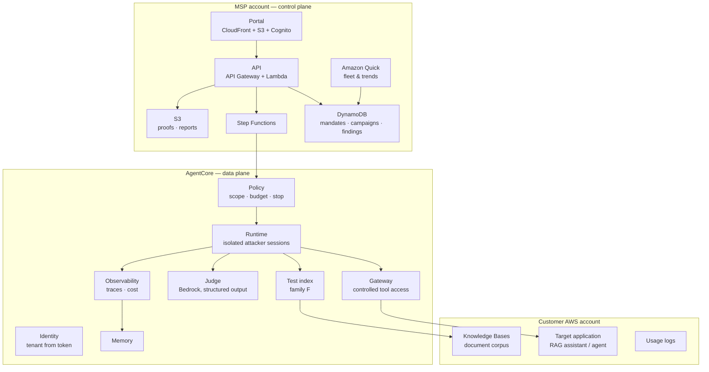

# Architecture — Piège

The principle, borrowed from the rest of the portfolio: **rules are enforced by
the gateway, not by the prompt**. The local Python implementation of the policy
(`src/piege/securite/politique.py`) is the reference; the AgentCore adapter
projects it and verifies that the remote decision matches the local one.

The full literary specification is in `docs/fr/CAHIER-DES-CHARGES.md` (French).
The frozen interface contracts are `docs/CONTRACTS.md`,
`docs/CONTRACTS-INTERFACES.md` and `docs/CONTRACTS-LOTS.md`. The traceability
matrix (`docs/TRACEABILITY.md`) maps every requirement to code and tests.
